# HUI

**A complete UI for World of Warcraft 3.3.5a (WotLK, build 12340) in a single addon.**

HUI is a flat, minimalist UI that replaces the default unit frames, raid and party frames, action bars, cast bars, auras, chat, minimap, bags, tooltips and nameplates. It also adds a cooldown manager with class panels with a layout for every spec, and skins every Blizzard window to match. It works out of the box, what you see in the screenshots is the default profile. You have an option for class color instead of dark theme. Addon usage is 2mb idle and about 5mb in combat.

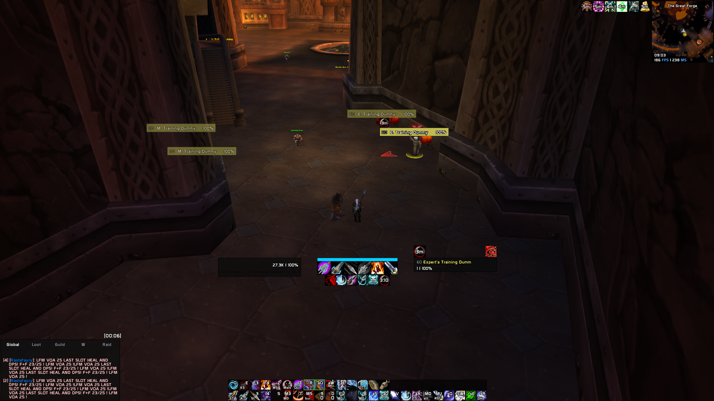

## Features

- **Unit frames:** Player, target (with target of target), focus, boss frames and pet frames. Party and raid frames (auto switches to centered for healer specs).
- **Cooldown manager:** A ready-made layout for each class and spec similar to WeakAuras, configurable on options.
- **Action bars:** All art is removed and the buttons are flat. 5 bars plus the pet and stance bars, optional mouseover bars.
- **Nameplates:** A health bar with the name and health inside it, a cast bar, and your debuffs on your target.
- **Buffs, bags, chat, minimap and tooltips:**
  - restyled buffs and debuffs
  - one-bag inventory
  - chat with timestamps, short channel names, clickable links and a text that you can copy
  - square minimap with mouse-wheel zoom, clock, FPS and latency
  - dark tooltips with option to anchor to cursor
- **Dark Blizzard windows:** The character, spellbook, talents, quests, inspect, merchants, mail, options and more use a dark panel instead of parchment, similar to ElvUI and Ellesmere.
- **Quality of life:**
  - auto-sell greys and auto-repair (guild funds first)
  - auto-accept invites, resurrects and summons, quests and role checks
  - fast loot, and DELETE typed for you
  - cursor circle, low-health warnings and combat timer
- **Profiles:** Export every setting as one text string to keep or share, and paste one in to load it.

## Screenshots

| | |
|---|---|
| 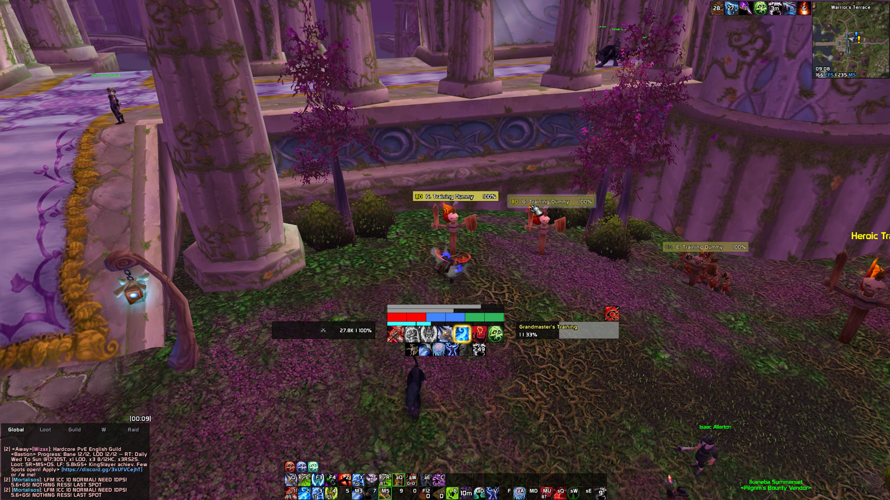 Death Knight | 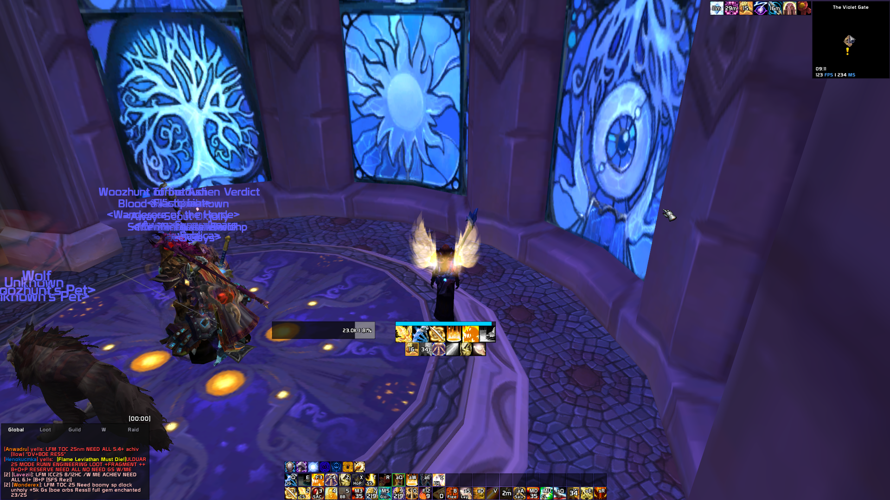 Paladin |
| 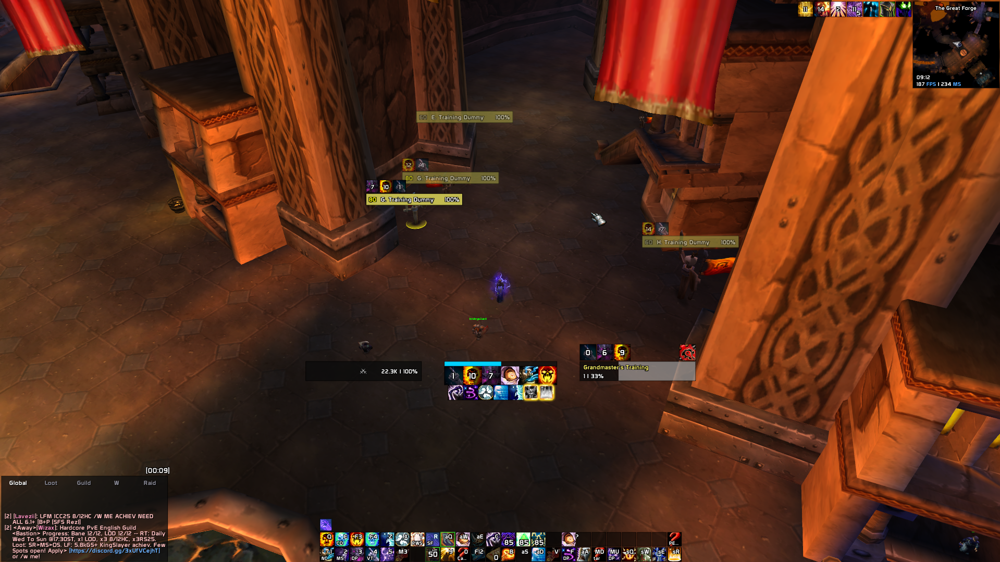 Shadow Priest | 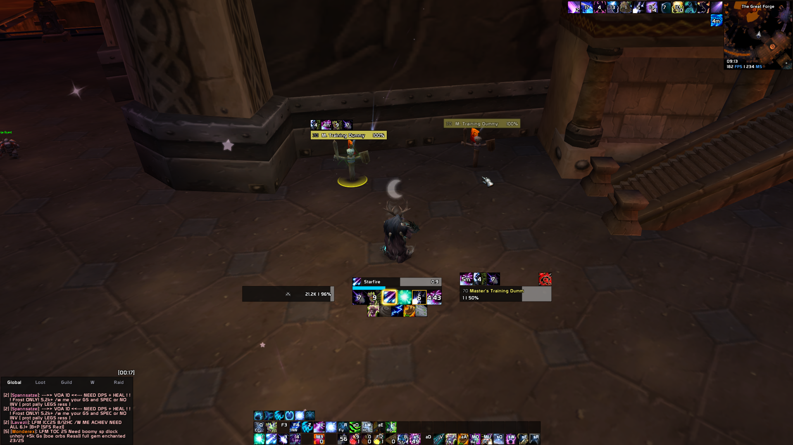 Balance Druid |
| 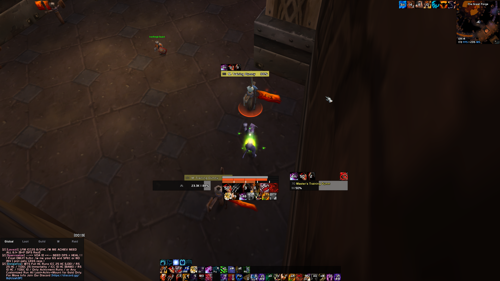 Feral Druid | 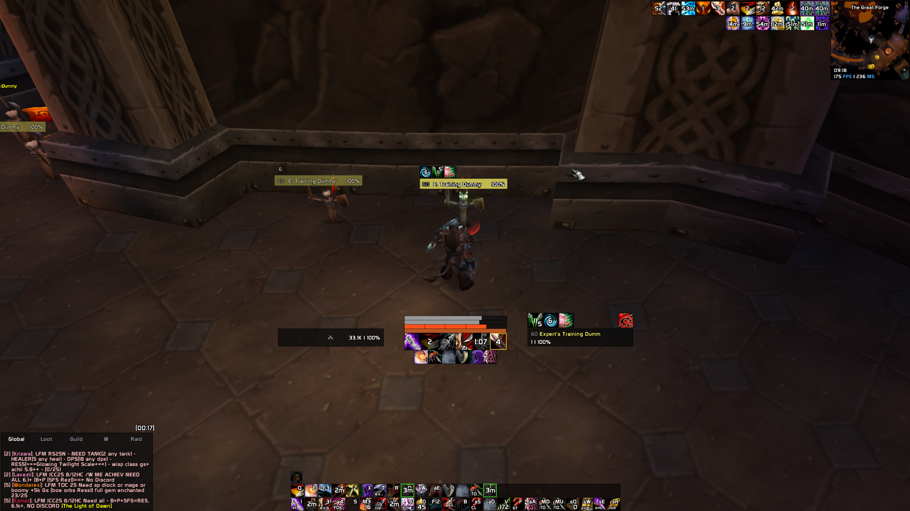 Rogue |
| 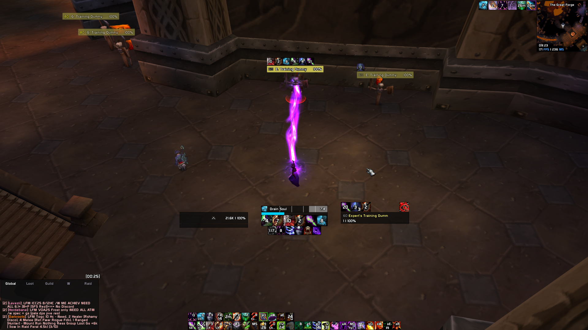 Warlock | 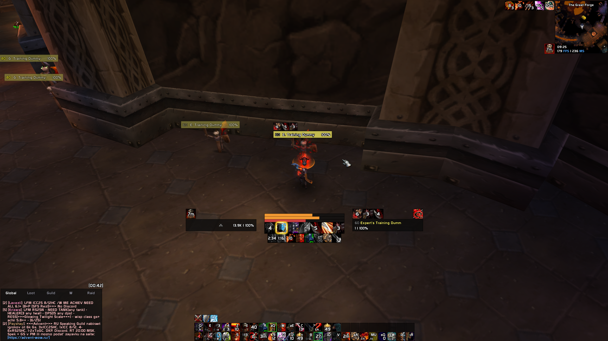 Warrior |
| 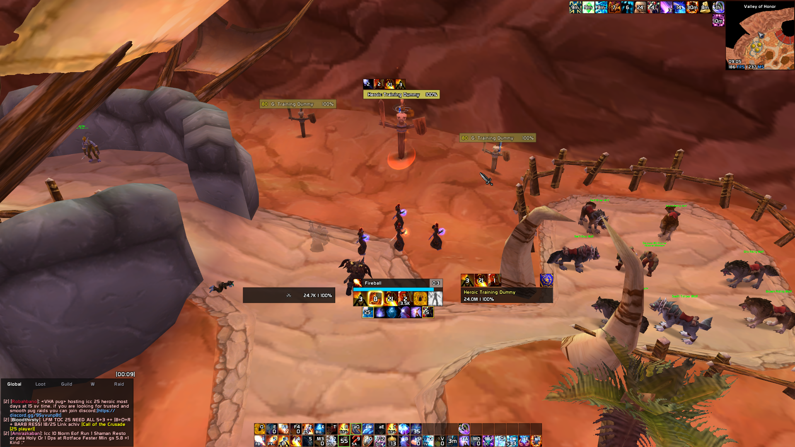 Fire Mage | 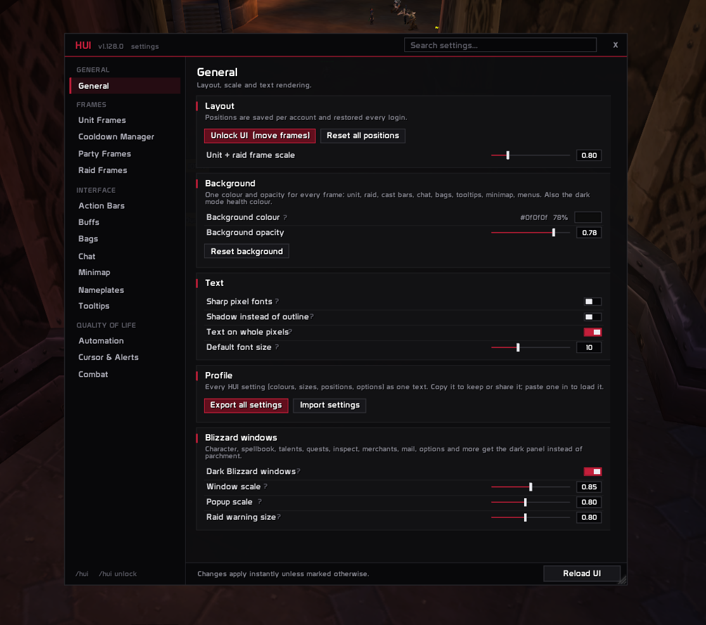 Addon settings window |
| 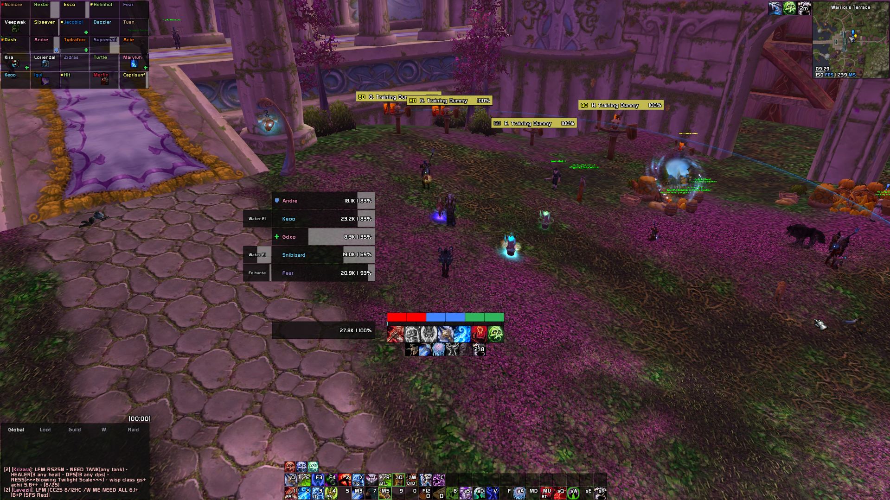 DPS / tank profile | 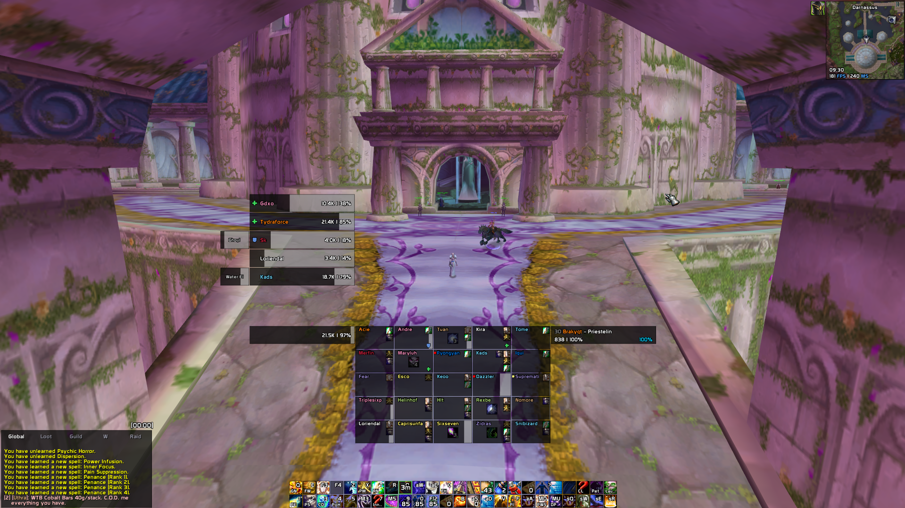 Healer profile |

## Installation

1. Download the latest release, or clone this repo.
2. Copy both the `HUI` and `HUI_Options` folders into `<WoW folder>\Interface\AddOns\`. Each `.toc` file has to end up directly inside its folder:
   - `Interface\AddOns\HUI\HUI.toc`
   - `Interface\AddOns\HUI_Options\HUI_Options.toc`
3. Enable **HUI** on the character screen. Tick "Load out of date AddOns" if the game asks.

`HUI_Options` contains the settings window. It only loads the first time you open the window, so it uses no memory until then.

## Usage

| Command | What it does |
|---|---|
| `/hui` | Opens the settings window - or click the icon under minimap. |

## F.A.Q.

**Q: How do I open the menu for character info, dungeon finder, guild etc?**
A: Middle click (mousewheel click) on the minimap.

Settings are saved per account in `WTF\Account\<account>\SavedVariables\HUI.lua`. Cooldown manager layouts are saved per character.
